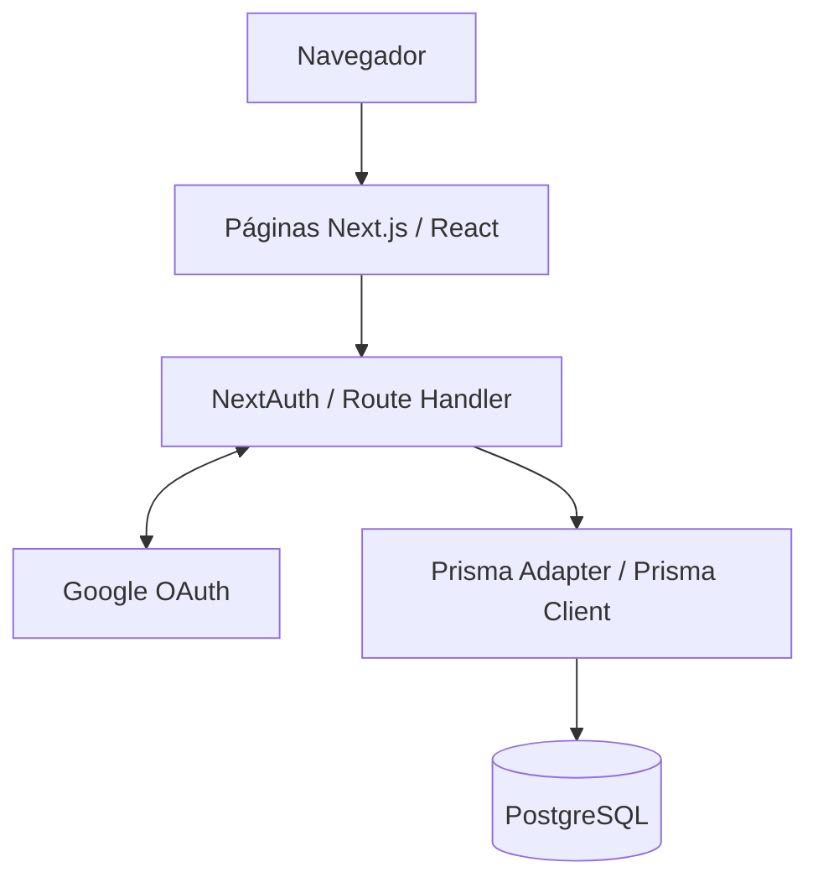

<h1 align="center">🎶 Sobe o Som</h1>

<p align="center">
    <strong>Discos para ouvir, capas para guardar.</strong>
</p>

<p align="center">
    E-commerce demonstrativo de discos de vinil, desenvolvido como projeto independente de estudo e portfólio.
</p>

<p align="center">
    
    
    
</p>

<p align="center">
    
    
    
    
    
    
</p>

<p align="center">
    
    
    
    
</p>

<p align="center">
    <a href="#sobre">Sobre</a> ·
    <a href="#funcionalidades">Funcionalidades</a> ·
    <a href="#tecnologias">Tecnologias</a> ·
    <a href="#execucao">Executar localmente</a> ·
    <a href="#roadmap">Roadmap</a>
</p>

> 🚧 **Projeto em desenvolvimento.** A base full stack, o banco de dados e o login com Google já estão implementados. A interface comercial e o fluxo de compra serão entregues nas próximas etapas. Este README diferencia os recursos disponíveis dos planejados.

---

## 📋 Índice

- [Sobre o projeto](#sobre)
- [Estado atual](#estado-atual)
- [Funcionalidades](#funcionalidades)
- [Tecnologias](#tecnologias)
- [Arquitetura e organização](#arquitetura)
- [Banco de dados](#banco-de-dados)
- [Autenticação e segurança](#autenticacao)
- [Mobile First e acessibilidade](#experiencia)
- [Execução local](#execucao)
- [Qualidade e testes](#qualidade)
- [Scripts disponíveis](#scripts)
- [Roadmap](#roadmap)
- [Documentação](#documentacao)
- [Autor](#autor)

---

<a id="sobre"></a>

## 💡 Sobre o projeto

O **Sobe o Som** está sendo desenvolvido para oferecer uma experiência de loja de discos: descobrir álbuns, explorar gêneros musicais, montar um carrinho e registrar pedidos demonstrativos.

A primeira versão utiliza **Next.js como aplicação full stack**, com React, TypeScript, Tailwind CSS, Prisma e PostgreSQL. O desenvolvimento segue uma abordagem **Mobile First**, com responsividade e acessibilidade como requisitos para a construção das telas.

O projeto reúne desafios de uma aplicação de comércio eletrônico:

- modelagem relacional e evolução do banco com migrações;
- autenticação social e gerenciamento de sessão;
- catálogo com busca, filtros, promoções e paginação;
- persistência do carrinho no navegador;
- validação de dados e cálculo de valores no servidor;
- criação consistente de pedidos, baixa transacional de estoque e autorização por usuário;
- múltiplos endereços por cliente e preenchimento assistido por CEP;
- testes de comportamento, documentação e integração contínua.

Esses recursos serão implementados de forma incremental, conforme o [roadmap](#roadmap).

**Limites da demonstração:** a loja será apresentada em português do Brasil, com valores em reais. A V1 incluirá múltiplos endereços por cliente, consulta de CEP e controle de estoque demonstrativo, com baixa transacional na confirmação do pedido. As compras serão simuladas, sem cobrança, integração de pagamento, cálculo de frete ou entrega real. O checkout solicitará endereço, mas não cartão ou CPF. Não haverá reserva de estoque nem cancelamento de pedidos na V1.

---

<a id="estado-atual"></a>

## 📌 Estado atual

| Área                            | Situação                                                                            |
| ------------------------------- | ----------------------------------------------------------------------------------- |
| Base da aplicação               | ✅ Next.js, App Router, TypeScript estrito e Tailwind configurados                  |
| Persistência                    | ✅ Prisma, PostgreSQL, migrações e seed com 6 gêneros e 24 discos fictícios         |
| Autenticação social             | ✅ Login e logout com Google, página `/login` e sessão JWT                          |
| Verificações de desenvolvimento | ✅ Formatação, lint, tipos, build e script de verificação de regras de autenticação |
| Interface da loja               | ⏳ Catálogo, navegação, busca, filtros e detalhes planejados                        |
| Fluxo de compra                 | ⏳ Carrinho, endereços, CEP, estoque, checkout simulado e pedidos planejados         |
| Login por e-mail e senha        | ⏳ Cadastro e provider de credenciais planejados                                    |
| Testes da loja, CI e publicação | ⏳ Previstos para a primeira versão completa                                        |
| API Nest.js e Docker            | 🔜 Evolução posterior à entrega da V1                                               |

A página inicial atual é uma base mínima em português do Brasil. A publicação da demonstração e os previews da interface fazem parte da entrega da V1.

---

<a id="funcionalidades"></a>

## ✨ Funcionalidades

### ✅ Disponíveis nesta etapa

- Login e logout com Google pela página `/login`.
- Criação de usuário e vínculo social no primeiro acesso válido.
- Reutilização da identidade do provedor em acessos posteriores.
- Sessão JWT gerenciada pelo NextAuth, com identificação do usuário na interface.
- Tratamento de cancelamento e falhas de autenticação.
- Base de catálogo persistida, com categorias, produtos, preços e dados de promoção.
- Seed reproduzível para preparar o ambiente de desenvolvimento.

### 🛍️ Catálogo e descoberta — planejados

- Vitrine com capas, títulos, artistas e preços.
- Busca por álbum ou artista.
- Filtros por gênero e seleção **Sale**, combináveis com a busca.
- Filtros preservados na URL e listagem paginada.
- Página de produto com descrição, ano de lançamento, gênero e quantidade.
- Produtos ativos esgotados ainda visíveis, identificados como **Esgotado** e sem novas adições.
- Cabeçalho com busca e categorias, carrossel editorial e rodapé institucional.
- Estados de carregamento, erro, catálogo vazio e produto não encontrado.

### 🛒 Carrinho e checkout — planejados

- Adicionar e remover discos, alterar quantidades e visualizar subtotal.
- Persistir o carrinho no mesmo navegador, inclusive para visitantes.
- Preservar os itens ao entrar na conta e limpar o carrinho ao sair.
- Exigir autenticação para concluir a compra simulada.
- Revalidar produtos, disponibilidade e preços no servidor.
- Informar mudanças de preço antes da confirmação.
- Solicitar endereço brasileiro, selecionar o principal por padrão e permitir escolher ou cadastrar outro no checkout.
- Preencher dados disponíveis por CEP via servidor, sem impedir preenchimento manual quando a consulta falhar.
- Não reservar estoque; confirmar a disponibilidade somente ao registrar o pedido.
- Prevenir pedidos duplicados por clique duplo ou repetição da mesma tentativa.

### 📦 Conta e pedidos — planejados

- Cadastro e login com e-mail e senha, além do Google já disponível.
- Armazenamento seguro do hash da senha.
- Múltiplos endereços vinculados ao cliente, inicialmente cadastrados e selecionados dentro do checkout.
- Criação do pedido, dos itens, da cópia do endereço confirmado e da baixa condicional de estoque em uma única transação.
- Confirmação com identificador, data, itens e total.
- Histórico paginado e detalhes acessíveis somente ao dono do pedido.
- Preservação do título, artista e preço de cada item no momento da compra.

---

<a id="tecnologias"></a>

## 🛠️ Tecnologias

### Em uso

| Tecnologia                      | Aplicação no projeto                             |
| ------------------------------- | ------------------------------------------------ |
| **Next.js 16 + App Router**     | Estrutura full stack, páginas e Route Handlers   |
| **React 19**                    | Interface e componentes interativos              |
| **TypeScript**                  | Tipagem estática em modo estrito                 |
| **Tailwind CSS 4**              | Estilização da interface                         |
| **Node.js 24**                  | Ambiente de execução                             |
| **Prisma 7**                    | Modelagem, migrações e acesso tipado aos dados   |
| **PostgreSQL 16**               | Persistência relacional                          |
| **`@prisma/adapter-pg` + `pg`** | Conexão do Prisma com PostgreSQL                 |
| **NextAuth 4 + Prisma Adapter** | Login com Google, vínculo de contas e sessão JWT |
| **ESLint + Prettier**           | Análise estática e padronização do código        |

As versões instaladas e os scripts estão registrados em [`package.json`](package.json) e [`package-lock.json`](package-lock.json).

### Planejadas

| Tecnologia                  | Finalidade                                         | Etapa |
| --------------------------- | -------------------------------------------------- | ----- |
| **Vitest**                  | Testes de regras de negócio                        | V1    |
| **React Testing Library**   | Testes de comportamento dos componentes            | V1    |
| **Playwright**              | Testes do fluxo completo no navegador              | V1    |
| **GitHub Actions**          | Integração contínua com verificações automatizadas | V1    |
| **Nest.js**                 | API separada para regras de negócio e persistência | V2    |
| **Docker + Docker Compose** | Ambiente reproduzível para aplicação e banco       | V2    |

---

<a id="arquitetura"></a>

## 🏗️ Arquitetura e organização

Na V1, interface e backend pertencem à mesma aplicação Next.js. O Prisma é utilizado exclusivamente no servidor, e o NextAuth atende as rotas de autenticação.

O diagrama representa a base de autenticação já implementada:



Para os próximos módulos, a organização prevista separa apresentação, regras de negócio e acesso aos dados. Server Components serão usados nas páginas de dados; Client Components, nas interações. As operações da loja utilizarão Server Actions quando apropriado, mantendo validação e autorização no servidor. A consulta planejada de CEP será a exceção HTTP explícita: `GET /api/cep/[cep]` consultará o ViaCEP pelo servidor e enviará ao provedor somente os oito dígitos necessários.

### Estrutura atual

| Caminho                 | Responsabilidade                                       |
| ----------------------- | ------------------------------------------------------ |
| `src/app/`              | Páginas, layout, estilos globais e rotas do App Router |
| `src/app/login/`        | Página e interface de autenticação                     |
| `src/app/api/auth/`     | Route Handler do NextAuth                              |
| `src/lib/auth.ts`       | Configuração da autenticação                           |
| `src/lib/auth-rules.ts` | Regras auxiliares de autenticação                      |
| `src/lib/prisma.ts`     | Acesso ao Prisma no servidor                           |
| `src/types/`            | Tipos complementares, incluindo a sessão               |
| `prisma/`               | Schema, migrações e seed                               |
| `prisma.config.ts`      | Configuração de URLs, migrações e seed                 |
| `scripts/`              | Verificações de autenticação e do ambiente de migração |
| `public/images/`        | Recursos visuais locais                                |
| `docs/`                 | Escopo e documentação técnica                          |

O código utiliza o alias `@/*` para importações a partir de `src/`.

### Evolução para a V2

Após a conclusão da V1, o backend será migrado para uma API **Nest.js**, preservando o frontend em Next.js e os dados do produto. A API assumirá também endereços, consulta de CEP e regras de estoque e pedidos. Essa etapa acrescentará Docker, documentação HTTP, testes de integração mais abrangentes e a apresentação e o registro versionado do aviso de privacidade.

A migração será uma evolução do mesmo projeto; a primeira versão terá sua própria entrega funcional.

---

<a id="banco-de-dados"></a>

## 🗄️ Banco de dados

### Modelos implementados

| Modelo     | Responsabilidade                                                          |
| ---------- | ------------------------------------------------------------------------- |
| `Category` | Gênero musical, com nome e slug únicos                                    |
| `Product`  | Álbum, artista, descrição, capa, preços, status e vínculo com a categoria |
| `User`     | Identidade interna, e-mail único e dados do usuário                       |
| `Account`  | Vínculo entre usuário e identidade OAuth do provedor                      |

Uma categoria possui vários produtos; um usuário pode possuir vínculos de autenticação. A combinação `provider` + `providerAccountId` é única.

Os modelos `Address`, `Order` e `OrderItem`, o campo `Product.stock` e o registro versionado de ciência/aceite de privacidade são planejados, não implementados. Não há tabela `Session`, pois a estratégia atual utiliza JWT.

### Decisões de modelagem

- **Valores monetários em centavos inteiros**, com restrições de integridade para os preços.
- **ID e slug únicos por produto**, permitindo álbuns com títulos iguais de artistas ou edições diferentes.
- **Sale derivada dos preços:** o preço de referência representa o valor anterior e deve ser maior que o preço atual. A promoção preserva o gênero do disco.
- **Migrações versionadas**, mantendo o histórico de evolução do banco.
- **Seed idempotente**, com `upsert` e UUIDs estáveis, sem remoção de registros.

Na evolução planejada, `Product.stock` será um inteiro não negativo, protegido também por `CHECK (stock >= 0)` no PostgreSQL. O seed aplicará estoques pequenos apenas ao criar novos produtos e fará uma inicialização única e controlada nos produtos já existentes, sem repor saldos consumidos nem apagar usuários ou pedidos quando for reexecutado.

O seed disponibiliza **6 gêneros e 24 discos fictícios**. As capas usam temporariamente [`album-placeholder.svg`](public/images/album-placeholder.svg) e serão substituídas por imagens próprias ou licenciadas.

O projeto utiliza Prisma **7.10.1**, gerador `prisma-client` com saída explícita e adaptador `@prisma/adapter-pg`. O cliente gerado fica em `src/generated/prisma`.

---

<a id="autenticacao"></a>

## 🔐 Autenticação e segurança

### Implementação atual

- **Google como único provedor social**, integrado pelo NextAuth 4.
- Criação de `User` e `Account` no primeiro login válido.
- Identificação de retornos pelo identificador estável do Google.
- Normalização de e-mail com remoção de espaços externos e conversão para minúsculas.
- Rejeição de perfis sem e-mail utilizável ou sem confirmação de e-mail pelo provedor.
- Ausência de vinculação automática de contas apenas por igualdade de e-mail.
- Sessão JWT gerenciada em **cookie HttpOnly**, sem armazenamento de autenticação em `localStorage`.
- Sessão pública limitada à expiração e aos dados necessários de identificação, incluindo o UUID interno do usuário.
- Validação dos destinos de retorno, evitando redirecionamentos externos indevidos.
- Segredos restritos ao servidor e configuração validada quando a autenticação é utilizada.

`session.maxAge` e `jwt.maxAge` estão configurados para **sete dias**. O NextAuth pode renovar a validade durante o uso da sessão. O logout remove o cookie do navegador; a estratégia atual não mantém registros de sessão no banco para revogação individual em outros dispositivos.

O fluxo real com Google já foi validado para primeiro acesso, persistência após atualização, cancelamento, logout seguido de atualização e novo login com a mesma conta. Este último manteve somente um `User` e um `Account`.

### Próximas etapas de segurança

O cadastro com senha, seu hash, a limitação de tentativas e a autorização de endereços e pedidos serão implementados nos respectivos módulos. Toda consulta ou alteração deverá obter o usuário da sessão no servidor, sem confiar em `userId` enviado pelo navegador.

Detalhes da estratégia e das verificações estão em [`docs/auth-model.md`](docs/auth-model.md).

---

<a id="experiencia"></a>

## 📱 Mobile First e acessibilidade

**Mobile First e responsividade são requisitos de toda a interface.** As telas serão construídas primeiro para dispositivos móveis e adaptadas progressivamente para tablets, notebooks e desktops.

A implementação da interface comercial deverá contemplar:

- layouts flexíveis e leitura confortável em diferentes larguras;
- busca, categorias e ações acessíveis em telas pequenas;
- áreas de toque adequadas e ações que não dependam apenas de hover;
- navegação por teclado e foco visível;
- rótulos de formulário e mensagens de erro associadas aos campos;
- textos alternativos, contraste e estrutura semântica;
- carrossel com controles acessíveis;
- respeito à preferência de redução de movimento.

A identidade visual terá **cabeçalho e catálogo brancos**, faixa com o slogan da marca e **rodapé preto**, valorizando as capas dos discos.

Esses itens orientam o desenvolvimento e a validação das próximas telas; a interface completa ainda está em construção.

---

<a id="execucao"></a>

## 💻 Execução local

### Pré-requisitos

| Ferramenta | Versão de referência |
| ---------- | -------------------- |
| Node.js    | `24.13.0`            |
| npm        | `11.6.2`             |
| PostgreSQL | `16`                 |

### 1. Clone e instale

```bash
git clone https://github.com/juniormps/sobe-o-som.git
cd sobe-o-som
nvm use
npm ci
```

O comando `nvm use` utiliza a versão registrada em `.nvmrc`. Se você não usa NVM, configure a versão indicada do Node.js pelo seu gerenciador de preferência.

O `postinstall` gera o Prisma Client sem abrir conexão com o banco e sem exigir credenciais reais.

### 2. Configure os bancos e as variáveis

Crie dois bancos PostgreSQL distintos, com acesso pelo usuário configurado no ambiente:

| Banco sugerido      | Uso                                   |
| ------------------- | ------------------------------------- |
| `sobe_o_som_dev`    | Dados da aplicação em desenvolvimento |
| `sobe_o_som_shadow` | Banco auxiliar do Prisma Migrate      |

Copie o arquivo de exemplo:

```bash
cp .env.example .env
```

Preencha o `.env` com os valores do seu ambiente:

| Variável               | Finalidade                                               |
| ---------------------- | -------------------------------------------------------- |
| `DATABASE_URL`         | Conexão com o banco principal                            |
| `SHADOW_DATABASE_URL`  | Conexão com o banco auxiliar de migrações                |
| `NEXTAUTH_URL`         | Origem da aplicação; localmente, `http://localhost:3000` |
| `NEXTAUTH_SECRET`      | Segredo aleatório e exclusivo do ambiente                |
| `GOOGLE_CLIENT_ID`     | Identificador do cliente OAuth do Google                 |
| `GOOGLE_CLIENT_SECRET` | Segredo do cliente OAuth do Google                       |

Os valores de `.env.example` são fictícios e devem ser substituídos. O `.env` permanece ignorado pelo Git. A configuração utiliza os nomes do **NextAuth 4**, como `NEXTAUTH_SECRET`.

Para usar o login com Google, configure um cliente OAuth para aplicação web e cadastre o callback local:

```text
http://localhost:3000/api/auth/callback/google
```

O banco shadow é usado exclusivamente por `migrate dev` para reaplicar o histórico e detectar divergências. Ele pode ser limpo pelo Prisma e não deve conter dados da aplicação. O script do projeto verifica as URLs e impede que banco principal e shadow apontem para o mesmo destino.

### 3. Prepare o banco

```bash
npm run prisma:generate
npm run prisma:validate
npm run prisma:migrate
npm run prisma:seed
```

Com um banco shadow dedicado previamente criado, o usuário local não precisa da permissão `CREATEDB` para esse fluxo.

### 4. Inicie a aplicação

```bash
npm run dev
```

- Aplicação: [http://localhost:3000](http://localhost:3000)
- Autenticação: [http://localhost:3000/login](http://localhost:3000/login)

### Build de produção

```bash
npm run build
npm start
```

O build gera o Prisma Client e compila a aplicação. A configuração de banco e autenticação é inicializada somente nas requisições que precisam dela, permitindo gerar o build sem conexão com o banco ou segredos reais.

**Build e `postinstall` não executam migrações nem seed.** O ambiente em execução precisa das variáveis correspondentes aos recursos utilizados. Variáveis obrigatórias ausentes e o placeholder de `NEXTAUTH_SECRET` são rejeitados, sem fallback para credenciais fictícias.

<details>
<summary><strong>Variáveis exigidas por operação</strong></summary>

| Operação                                                                                 | Variáveis necessárias                                                                          |
| ---------------------------------------------------------------------------------------- | ---------------------------------------------------------------------------------------------- |
| `prisma:generate`, `prisma:validate`, `postinstall` e `build`                            | Não exigem conexão com o banco nem segredos reais de autenticação                              |
| Acesso ao banco pela aplicação, `prisma:seed`, `prisma:studio` e `prisma:migrate:status` | `DATABASE_URL`                                                                                 |
| Requisições de autenticação                                                              | `DATABASE_URL`, `NEXTAUTH_URL`, `NEXTAUTH_SECRET`, `GOOGLE_CLIENT_ID` e `GOOGLE_CLIENT_SECRET` |
| `prisma:migrate` em desenvolvimento                                                      | `DATABASE_URL` e `SHADOW_DATABASE_URL`, apontando para bancos distintos                        |
| Migrações no futuro ambiente de produção                                                 | `DATABASE_URL`, sem banco shadow                                                               |

</details>

---

<a id="qualidade"></a>

## 🧪 Qualidade e testes

### Verificações disponíveis

```bash
npm run auth:verify
npm run format:check
npm run lint
npm run typecheck
npm run build
```

O script `auth:verify` verifica regras de autenticação, incluindo normalização de e-mail, rejeição de perfis inválidos, destinos de retorno e conteúdo público da sessão. Ele complementa a validação manual do OAuth real com Google.

O código utiliza **quatro espaços de indentação**, sem tabulações. Para aplicar a formatação:

```bash
npm run format
```

### Cobertura planejada para a V1

| Nível             | Principais comportamentos a verificar                                        |
| ----------------- | ---------------------------------------------------------------------------- |
| Regras de negócio | Valores em centavos, quantidades, produtos inativos e validação das entradas |
| Componentes       | Interações do catálogo, carrinho, formulários e estados de interface         |
| Integração        | Endereços, CEP controlado, estoque, transações, autorização e idempotência    |
| End-to-end        | Catálogo, carrinho, autenticação, endereço, revisão, pedido e histórico       |

Vitest, React Testing Library, Playwright e o pipeline do GitHub Actions ainda serão incorporados. O script de autenticação existente não representa a suíte completa de testes da loja.

Os testes planejados cobrirão disputa concorrente pela última unidade, reversão integral de pedidos com vários itens, repetição da confirmação, preservação do estoque ao reexecutar o seed, isolamento dos endereços por usuário e imutabilidade do endereço histórico do pedido. Também cobrirão consulta de CEP com sucesso, entrada inválida, CEP não encontrado, falha, tempo limite, preenchimento manual e descarte de respostas atrasadas. Concorrência e transações usarão PostgreSQL real isolado, sem consumir o banco demonstrativo; a API externa será simulada ou controlada nos testes automatizados.

---

<a id="scripts"></a>

## 📜 Scripts disponíveis

| Comando                         | Descrição                                                |
| ------------------------------- | -------------------------------------------------------- |
| `npm run dev`                   | Inicia o ambiente de desenvolvimento                     |
| `npm run build`                 | Gera o Prisma Client e o build de produção               |
| `npm start`                     | Executa a aplicação compilada                            |
| `npm run format`                | Aplica a formatação com Prettier                         |
| `npm run format:check`          | Verifica a formatação                                    |
| `npm run lint`                  | Executa o ESLint                                         |
| `npm run typecheck`             | Gera os tipos do Next.js e verifica o TypeScript         |
| `npm run auth:verify`           | Verifica regras auxiliares de autenticação               |
| `npm run prisma:format`         | Formata o schema Prisma                                  |
| `npm run prisma:generate`       | Gera o Prisma Client                                     |
| `npm run prisma:validate`       | Valida o schema Prisma                                   |
| `npm run prisma:migrate`        | Valida as URLs e executa as migrações de desenvolvimento |
| `npm run prisma:migrate:status` | Consulta o estado das migrações                          |
| `npm run prisma:seed`           | Cria ou atualiza o catálogo demonstrativo                |
| `npm run prisma:studio`         | Abre a interface de inspeção do banco                    |

---

<a id="roadmap"></a>

## 🗺️ Roadmap

### V1 — E-commerce full stack com Next.js

- [x] Configurar Next.js, TypeScript, Tailwind e ferramentas de qualidade.
- [x] Integrar PostgreSQL e Prisma, com migrações versionadas.
- [x] Modelar categorias e produtos e preparar o seed.
- [x] Implementar a base de autenticação e o login com Google.
- [x] Revisar documentalmente o escopo de endereços, CEP, estoque e privacidade.
- [ ] Preparar a base de estoque antes da M2, com migração e seed sem reposição de saldo.
- [ ] Construir a interface Mobile First, responsiva e acessível.
- [ ] Implementar a M2 com catálogo, busca, gêneros, Sale, paginação, detalhes e estado esgotado.
- [ ] Implementar a M3 com carrinho persistente atento à disponibilidade, sem reserva.
- [ ] Adicionar cadastro e login com e-mail e senha.
- [ ] Integrar múltiplos endereços e consulta de CEP na etapa de checkout.
- [ ] Implementar pedidos com baixa transacional, idempotência e testes de concorrência.
- [ ] Implementar confirmação e histórico de pedidos com cópias dos dados históricos.
- [ ] Ampliar testes e configurar integração contínua.
- [ ] Validar a experiência completa, publicar a demonstração e adicionar previews.

### V2 — API dedicada e ambiente com Docker

- [ ] Migrar o backend para Nest.js, preservando o frontend e os dados.
- [ ] Centralizar autenticação, endereços, CEP, estoque, pedidos e persistência na API.
- [ ] Apresentar aviso de privacidade versionado e registrar a manifestação explícita do usuário.
- [ ] Documentar o contrato HTTP com OpenAPI/Swagger.
- [ ] Configurar Docker e Docker Compose para o ambiente local.
- [ ] Ampliar testes de integração e repetir os fluxos end-to-end.
- [ ] Documentar e publicar a evolução da arquitetura.

O escopo detalhado e os critérios de aceite estão em [`docs/escopo-projeto-ecommerce.md`](docs/escopo-projeto-ecommerce.md).

---

<a id="documentacao"></a>

## 📚 Documentação

| Documento                                             | Conteúdo                                                                  |
| ----------------------------------------------------- | ------------------------------------------------------------------------- |
| [Escopo do projeto](docs/escopo-projeto-ecommerce.md) | Funcionalidades, regras de negócio, identidade visual e plano de evolução |
| [Modelo de autenticação](docs/auth-model.md)          | Identidades, contas sociais, sessão, decisões e verificações              |
| [Schema Prisma](prisma/schema.prisma)                 | Modelos e relacionamentos implementados                                   |
| [Migrações](prisma/migrations/)                       | Histórico de alterações no banco                                          |
| [Variáveis de exemplo](.env.example)                  | Referência para configurar o ambiente local                               |

---

<a id="autor"></a>

## 👨‍💻 Autor

Desenvolvido por **Márcio Junior** como projeto independente de estudo e portfólio em desenvolvimento de software.

[](https://github.com/juniormps)

Conheça também o [Clarity](https://github.com/juniormps/clarity), aplicação full stack de gerenciamento de tarefas.

---

<p align="center">
    <strong>🎶 Sobe o Som — Discos para ouvir, capas para guardar.</strong>
</p>
